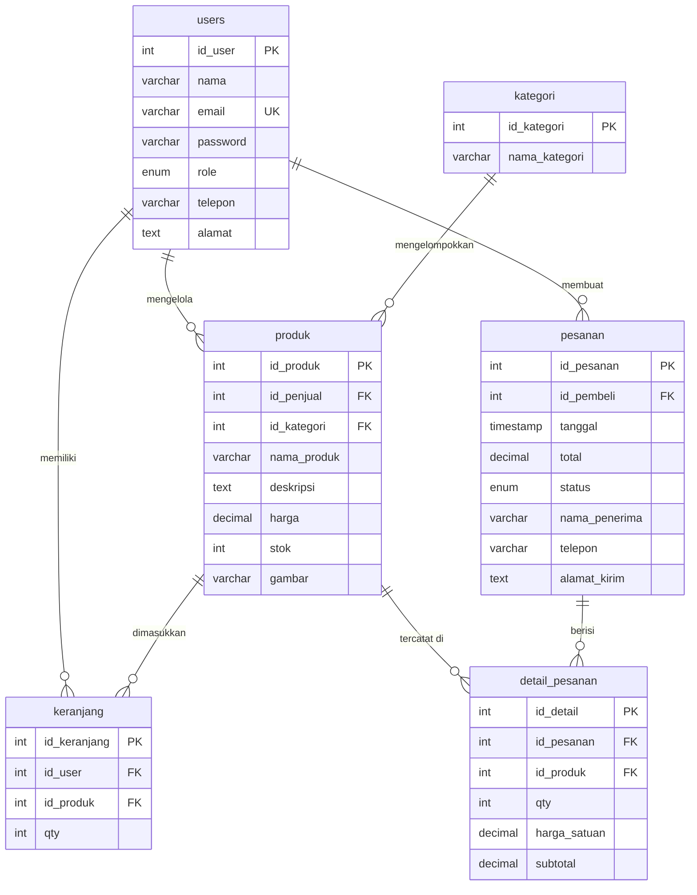

# DOKUMENTASI — APLIKASI WEB MARKETPLACE TERNAK (BangkokFarm)

> **Soal 11** — Perancangan dan Pembangunan Aplikasi Web Marketplace Peternakan Ayam
> Stack: **PHP Native + MySQLi + Bootstrap 5.3 + Custom Modern Theme**
> Studi kasus: Sentra Jual Beli Ayam Bangkok, Ayam Laga Trah Unggul & Bibit Ternak (BangkokFarm)

---

## A. ANALISIS DAN PERANCANGAN SISTEM

### a. Identifikasi Entitas (minimal 5 entitas)

Aplikasi ini memiliki **6 entitas** utama:

| No | Entitas | Deskripsi |
|----|---------|-----------|
| 1 | **users** | Pengguna aplikasi yang memiliki peran `admin` dan `user`. Admin mengelola produk & pesanan, user (pembeli) melakukan pemesanan. |
| 2 | **kategori** | Klasifikasi produk (mis. Ayam Potong, Telur, Frozen Food) untuk mempermudah pencarian. |
| 3 | **produk** | Barang yang dikelola admin, memiliki harga dan stok. |
| 4 | **keranjang** | Item produk yang dipilih user sebelum melakukan checkout. |
| 5 | **pesanan** | Header transaksi pemesanan (data user, total, status, alamat kirim). |
| 6 | **detail_pesanan** | Rincian baris produk pada setiap pesanan (qty, harga satuan, subtotal). |

Entitas `pesanan` dan `detail_pesanan` dipisahkan untuk memenuhi **normalisasi** (hubungan many-to-many antara pesanan dan produk dipecah menjadi dua tabel).

### b. Rancangan Database Relasional

**Nama database:** `db_marketplace_ayam`

#### 1) Tabel `users`
| Atribut | Tipe | Keterangan |
|---------|------|-----------|
| **id_user** 🔑 | INT, AUTO_INCREMENT | **Primary Key** |
| nama | VARCHAR(100) | Nama pengguna |
| email | VARCHAR(100) UNIQUE | Login, harus unik |
| password | VARCHAR(255) | Hash password (bcrypt) |
| role | ENUM('admin','user') | Peran pengguna |
| telepon | VARCHAR(20) | No. telepon |
| alamat | TEXT | Alamat |
| created_at | TIMESTAMP | Waktu registrasi |

#### 2) Tabel `kategori`
| Atribut | Tipe | Keterangan |
|---------|------|-----------|
| **id_kategori** 🔑 | INT, AUTO_INCREMENT | **Primary Key** |
| nama_kategori | VARCHAR(50) | Nama kategori |

#### 3) Tabel `produk`
| Atribut | Tipe | Keterangan |
|---------|------|-----------|
| **id_produk** 🔑 | INT, AUTO_INCREMENT | **Primary Key** |
| id_penjual 🔗 | INT | **FK** → `users.id_user` |
| id_kategori 🔗 | INT | **FK** → `kategori.id_kategori` |
| nama_produk | VARCHAR(150) | Nama produk |
| deskripsi | TEXT | Deskripsi produk |
| harga | DECIMAL(12,2) | Harga satuan |
| stok | INT | Jumlah stok |
| gambar | VARCHAR(255) | Nama file / URL gambar |
| created_at | TIMESTAMP | Waktu input |

#### 4) Tabel `keranjang`
| Atribut | Tipe | Keterangan |
|---------|------|-----------|
| **id_keranjang** 🔑 | INT, AUTO_INCREMENT | **Primary Key** |
| id_user 🔗 | INT | **FK** → `users.id_user` |
| id_produk 🔗 | INT | **FK** → `produk.id_produk` |
| qty | INT | Jumlah |
| — | UNIQUE(id_user, id_produk) | 1 produk 1 baris per user |

#### 5) Tabel `pesanan`
| Atribut | Tipe | Keterangan |
|---------|------|-----------|
| **id_pesanan** 🔑 | INT, AUTO_INCREMENT | **Primary Key** |
| id_pembeli 🔗 | INT | **FK** → `users.id_user` |
| tanggal | TIMESTAMP | Waktu pesanan |
| total | DECIMAL(12,2) | Total bayar |
| status | ENUM('pending','diproses','dikirim','selesai','batal') | Status pesanan |
| nama_penerima | VARCHAR(100) | Nama penerima |
| telepon | VARCHAR(20) | No. telepon penerima |
| alamat_kirim | TEXT | Alamat pengiriman |

#### 6) Tabel `detail_pesanan`
| Atribut | Tipe | Keterangan |
|---------|------|-----------|
| **id_detail** 🔑 | INT, AUTO_INCREMENT | **Primary Key** |
| id_pesanan 🔗 | INT | **FK** → `pesanan.id_pesanan` |
| id_produk 🔗 | INT | **FK** → `produk.id_produk` |
| qty | INT | Jumlah beli |
| harga_satuan | DECIMAL(12,2) | Harga saat transaksi |
| subtotal | DECIMAL(12,2) | qty × harga_satuan |

#### Hubungan antar tabel (relasi)
- `users (1) ──< produk (N)` : satu admin mengelola banyak produk.
- `kategori (1) ──< produk (N)` : satu kategori memuat banyak produk.
- `users (1) ──< keranjang (N)` : satu user memiliki banyak item keranjang.
- `produk (1) ──< keranjang (N)` : satu produk dapat muncul di banyak keranjang.
- `users (1) ──< pesanan (N)` : satu user membuat banyak pesanan.
- `pesanan (1) ──< detail_pesanan (N)` : satu pesanan memiliki banyak baris detail.
- `produk (1) ──< detail_pesanan (N)` : satu produk dapat ada di banyak detail pesanan.

### c. ERD (Entity Relationship Diagram)



**Hubungan ringkas (crow's foot):**

```
users(1) ─────< produk(N) >─────(1)kategori
users(1) ─────< keranjang(N) >──(1)produk
users(1) ─────< pesanan(N) ─────< detail_pesanan(N) >──(1)produk
```

### d. Alur Proses Transaksi

Alur dari pembeli memilih produk sampai pesanan tersimpan ke database:

```
[1] Pembeli membuka halaman Daftar Produk (index.php)
        │  (bisa mencari / memfilter kategori)
        ▼
[2] Pembeli membuka Detail Produk (detail.php?id=..)
        │
        ▼
[3] Pembeli klik "Tambah ke Keranjang"
        │  → aksi_keranjang.php (aksi=tambah)
        │  → validasi stok, INSERT/UPDATE tabel `keranjang`
        ▼
[4] Pembeli membuka Keranjang (keranjang.php)
        │  (ubah qty / hapus item)
        ▼
[5] Pembeli klik "Lanjut ke Checkout" (checkout.php)
        │  mengisi nama penerima, telepon, alamat
        ▼
[6] Klik "Buat Pesanan" → checkout.php (POST)
        │  ┌─────────────────────────────────────────────┐
        │  │ TRANSAKSI DATABASE (begin_transaction)      │
        │  │  1. Validasi stok terbaru tiap item         │
        │  │  2. INSERT ke `pesanan` (header + total)    │
        │  │  3. INSERT ke `detail_pesanan` tiap item    │
        │  │  4. UPDATE `produk.stok` (stok - qty)       │
        │  │  5. DELETE `keranjang` milik pembeli        │
        │  │  commit() — jika error: rollback()          │
        │  └─────────────────────────────────────────────┘
        ▼
[7] Redirect ke pesanan_sukses.php?id=.. (bukti pesanan)
        │
        ▼
[8] Penjual/Admin melihat pesanan di kelola/pesanan.php
        │  dan mengubah status: pending → diproses → dikirim → selesai
        ▼
[9] Pembeli memantau status di riwayat.php (Pesanan Saya)
```

### e. Rancangan Antarmuka (Mockup UI)

#### 1) Halaman Daftar Produk (index.php)
```
┌───────────────────────────────────────────────────────────────┐
│  [LOGO AyamMart]   Daftar Produk  Kelola  Pesanan  [🛒 Keranjang]│
├───────────────────────────────────────────────────────────────┤
│   ▓▓ HERO: Selamat Datang di AyamMart (banner oranye-merah) ▓▓  │
├───────────────────────────────────────────────────────────────┤
│  [🔎 Cari produk...]        [▼ Semua Kategori]      [ Cari ]    │
├───────────────────────────────────────────────────────────────┤
│  ┌──────────┐  ┌──────────┐  ┌──────────┐  ┌──────────┐        │
│  │  GAMBAR  │  │  GAMBAR  │  │  GAMBAR  │  │  GAMBAR  │        │
│  │ [Ayam]   │  │ [Telur]  │  │ [Fillet] │  │ [Nugget] │        │
│  ├──────────┤  ├──────────┤  ├──────────┤  ├──────────┤        │
│  │Nama Produk│ │Nama Produk│ │Nama Produk│ │Nama Produk│       │
│  │ Toko Ayam│  │ Toko Ayam│  │ Toko Ayam│  │ Toko Ayam│        │
│  │Rp 35.000 │  │Rp 28.000 │  │Rp 42.000 │  │Rp 25.000 │        │
│  │[Lihat ▼] │  │[Lihat ▼] │  │[Lihat ▼] │  │[Lihat ▼] │        │
│  └──────────┘  └──────────┘  └──────────┘  └──────────┘        │
└───────────────────────────────────────────────────────────────┘
```

#### 2) Halaman Detail Produk (detail.php)
```
┌───────────────────────────────────────────────────────────────┐
│  Produk / Ayam Potong / Ayam Broiler Utuh 1 Kg   (breadcrumb)   │
├──────────────────────────────┬────────────────────────────────┤
│                              │ [Ayam Potong]  ← kategori       │
│        GAMBAR PRODUK         │ Ayam Broiler Utuh 1 Kg (judul)  │
│         (besar)              │ 🏪 Dijual oleh Toko Ayam Segar  │
│                              │ Rp 35.000    (harga besar)      │
│                              │ Stok tersedia: 50               │
│                              │ Deskripsi produk...             │
│                              │                                 │
│                              │ [Qty: 2] [🛒 Tambah ke Keranjang]│
├──────────────────────────────┴────────────────────────────────┤
│  Produk Terkait:  [card] [card] [card] [card]                   │
└───────────────────────────────────────────────────────────────┘
```

#### 3) Halaman Keranjang Belanja (keranjang.php)
```
┌───────────────────────────────────────────────────────────────┐
│  🛒 Keranjang Belanja                                           │
├────────────────────────────────────────┬──────────────────────┤
│ Produk          Harga    Qty   Subtotal │  Ringkasan Belanja   │
│ ┌────┬────────┐                        │  ─────────────────   │
│ │img │Ayam Utuh│ Rp35.000 [2][↻] Rp70.000 [🗑]│ Total Item: 5 pcs│
│ ├────┼────────┤                        │  Total Harga:        │
│ │img │Paha Bwh │ Rp32.000 [3][↻] Rp96.000 [🗑]│ Rp 166.000       │
│ └────┴────────┘                        │ [ Lanjut ke Checkout]│
│  Kosongkan keranjang                     │ [ Lanjut Belanja ]  │
└────────────────────────────────────────┴──────────────────────┘
```

> Mockup di atas mengikuti implementasi nyata pada file `index.php`, `detail.php`, dan `keranjang.php` (Bootstrap 5).

---

## B. IMPLEMENTASI APLIKASI

Aplikasi diimplementasikan dengan **PHP Native**, **ekstensi MySQLi (prepared statement)**, dan **Bootstrap 5**.

### Struktur folder
```
web_penjualanAyam/
├── index.php              # Daftar produk + pencarian & filter
├── detail.php             # Detail produk
├── keranjang.php          # Keranjang belanja
├── aksi_keranjang.php     # Proses tambah/ubah/hapus item keranjang
├── checkout.php           # Form & simpan transaksi (DB transaction)
├── pesanan_sukses.php     # Konfirmasi pesanan
├── riwayat.php            # Riwayat pesanan pembeli
├── login.php / register.php / logout.php   # Autentikasi
├── config/koneksi.php     # Koneksi MySQLi
├── includes/
│   ├── fungsi.php         # Helper (rupiah, flash, auth, keamanan)
│   ├── header.php         # Navbar + head (Bootstrap)
│   └── footer.php
├── kelola/                # Panel admin (CRUD produk & pesanan)
│   ├── index.php          # Dashboard & statistik
│   ├── produk.php         # Daftar produk (CRUD)
│   ├── produk_form.php    # Tambah / Edit produk (+ upload gambar)
│   ├── produk_hapus.php   # Hapus produk
│   └── pesanan.php        # Daftar pesanan + ubah status
├── assets/css/style.css
├── assets/img/produk/     # Folder gambar unggahan
└── database/marketplace.sql   # Skema + data contoh
```

### Fitur yang dipenuhi
| Ketentuan | Status | Lokasi |
|-----------|--------|--------|
| Menampilkan daftar produk | ✅ | `index.php` |
| Menampilkan detail produk | ✅ | `detail.php` |
| Mengelola data produk (CRUD) | ✅ | `kelola/produk*.php` |
| Menambahkan produk ke keranjang | ✅ | `aksi_keranjang.php`, `keranjang.php` |
| Membuat & menyimpan transaksi pemesanan | ✅ | `checkout.php` (tabel `pesanan` + `detail_pesanan`) |

### Catatan keamanan
- Semua query menggunakan **prepared statement** (mencegah SQL Injection).
- Output di-escape dengan `htmlspecialchars` (mencegah XSS).
- Password disimpan dengan `password_hash()` (bcrypt) dan diverifikasi `password_verify()`.
- Transaksi database memakai `begin_transaction` / `commit` / `rollback` agar stok dan pesanan konsisten.
- Kontrol akses berbasis peran (`wajib_login()`, `wajib_role()`).

### Akun demo
| Peran | Email | Password |
|-------|-------|----------|
| Admin | admin@ayammart.test | admin123 |
| User | user@ayammart.test | user123 |

### Cara menjalankan di XAMPP (lokal)
1. Salin folder proyek ke `C:\xampp\htdocs\web_penjualanAyam`.
2. Jalankan **Apache** & **MySQL** dari XAMPP Control Panel.
3. Impor database: buka `http://localhost/phpmyadmin` → Import → pilih `database/marketplace.sql`
   (atau via CLI: `mysql -u root -e "source database/marketplace.sql"`).
4. Akses aplikasi di `http://localhost/web_penjualanAyam/`.

---

## C. DEPLOYMENT DAN PUBLIKASI SOURCE CODE

### Deploy ke hosting gratis InfinityFree (`https://infinityfree.com`)

**1. Membuat akun & hosting**
1. Daftar/login di `https://infinityfree.com`.
2. **Create Account** → pilih subdomain gratis (mis. `ayammart.infinityfreeapp.com`) → Create.
3. Tunggu hingga status akun aktif, lalu buka **Control Panel (vPanel)**.

**2. Membuat database MySQL**
1. Di vPanel buka **MySQL Databases** → buat database.
2. Catat kredensial yang diberikan, contoh:
   - Host: `sqlXXX.infinityfree.com`
   - Database: `if0_XXXXXXX_ayammart`
   - Username: `if0_XXXXXXX`
   - Password: (sesuai yang Anda set)

**3. Impor database**
1. Buka **phpMyAdmin** dari vPanel.
2. Pilih database Anda → tab **Import** → unggah `database/marketplace.sql` → **Go**.

**4. Menyesuaikan konfigurasi koneksi**
Edit `config/koneksi.php` sesuai kredensial hosting InfinityFree:
```php
define('DB_HOST', 'sqlXXX.infinityfree.com'); // host dari vPanel
define('DB_USER', 'if0_XXXXXXX');             // username hosting
define('DB_PASS', 'password_anda');           // password database
define('DB_NAME', 'if0_XXXXXXX_ayammart');    // nama database

// Karena aplikasi berada di root domain, BASE_URL diubah menjadi '' (kosong)
define('BASE_URL', '');
```

**5. Mengunggah file aplikasi**
1. Di vPanel buka **Online File Manager** (atau gunakan FTP seperti FileZilla).
2. Masuk ke folder **`htdocs`**.
3. Unggah **seluruh isi folder proyek** ke dalam `htdocs`
   (struktur: `htdocs/index.php`, `htdocs/config/...`, `htdocs/kelola/...`, dst.).
4. Pastikan folder `assets/img/produk/` ada dan memiliki izin tulis (chmod `755`/`777`).

**6. Menguji aplikasi**
1. Buka `http://ayammart.infinityfreeapp.com` di browser.
2. Uji: daftar produk → detail → tambah keranjang → checkout → cek pesanan muncul di `kelola/pesanan.php`.

**7. Publikasi source code**
1. Inisialisasi Git pada folder proyek, lalu unggah ke GitHub:
   ```bash
   git init
   git add .
   git commit -m "Aplikasi Web Marketplace AyamMart (PHP Native + MySQLi + Bootstrap)"
   git branch -M main
   git remote add origin https://github.com/USERNAME/web_penjualanAyam.git
   git push -u origin main
   ```
2. Cantumkan link GitHub dan link aplikasi live pada laporan/pengumpulan tugas.

> **Catatan:** InfinityFree tidak mengizinkan koneksi database dari luar (remote MySQL), sehingga
> impor database harus dilakukan melalui phpMyAdmin vPanel, bukan dari komputer lokal.

---

## Ringkasan Pemenuhan Soal

| Butir | Keterangan | Status |
|-------|-----------|--------|
| a | 6 entitas diidentifikasi | ✅ |
| b | Rancangan DB relasional (PK, FK, relasi) | ✅ (`database/marketplace.sql`) |
| c | ERD | ✅ (bagian A.c) |
| d | Alur proses transaksi | ✅ (bagian A.d) |
| e | Mockup UI (daftar, detail, keranjang) | ✅ (bagian A.e) |
| f | PHP Native + MySQLi + Bootstrap | ✅ |
| g | Daftar, detail, CRUD, keranjang, transaksi | ✅ |
| h | Deployment InfinityFree | ✅ (bagian C) |
